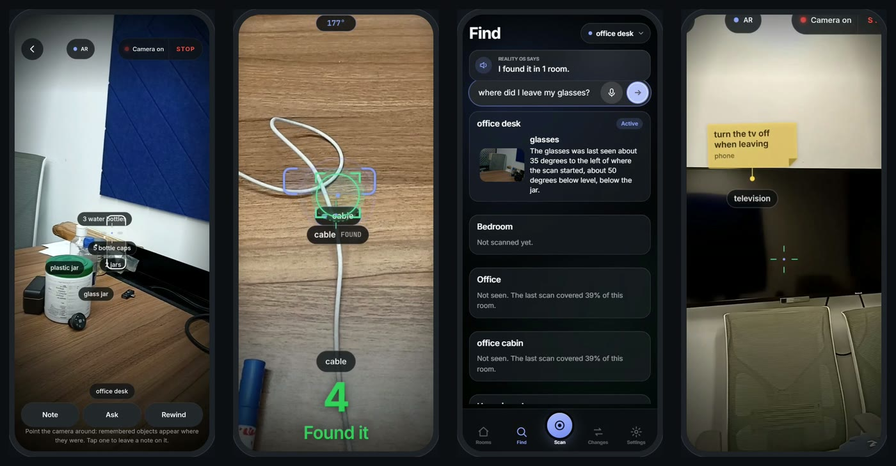
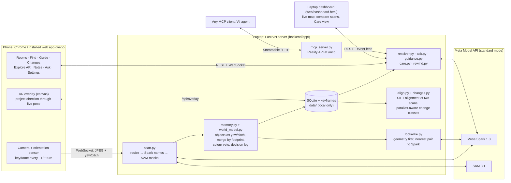

# Reality OS

**A phone camera gives a room a memory.** Turn around once; Reality OS remembers what is where, guides you back to it, notices what moved, holds notes in place for the next person, and lets a caregiver or another AI agent ask the room.

**Demo video (2:54):** [youtu.be/7z2lf3IXyDg](https://youtu.be/7z2lf3IXyDg)



Solo entry, Meta hackathon, Indie track. MIT licensed ([LICENSE](LICENSE)). An experimental prototype, not a medical or safety device.

## The problem

"Where did I put it?" For most people it is a lost minute. For someone living with memory loss it comes back all day, and the person who looks after them cannot always be in the room to answer. Photos do not answer it, and a camera that watches a home all day is not something most people want. Reality OS needs one scan of a room from an ordinary phone, keeps the memory on your own computer, and shares nothing with a caregiver until the person turns sharing on.

## What it does

- **Scan a room once, anchored by orientation.** You pan the phone around; every object is stored as a compass direction (yaw and pitch from the phone's orientation sensor) from where you stood, never as a guessed distance. No LiDAR or depth sensor needed.
- **Find by meaning, in one room or all of them.** "The thing I charge my laptop with" resolves to *charger*; "where did I leave my glasses?" searches every scanned room and says which one, with the photo it was seen in.
- **Guided retrieval.** An arrow over the live camera turns you toward the object, step by step, until it says *Found it*.
- **What changed, with honest uncertainty.** Two scans are lined up from their pictures, and each object is judged against how far a different standing spot alone could shift it: *moved*, *possibly moved*, *moved (low confidence)*, *new*, *gone* or *can't compare*, with the reason. When the scans line up badly it says "check it" instead of guessing.
- **Notes in places, and a caregiver view.** Leave a note on the TV ("turn it off when leaving"); it shows over the camera to anyone who looks there. With the person's consent, a caregiver's laptop dashboard watches the things that matter (glasses, keys, pills), asks where they are, and leaves notes on objects for them.
- **The Reality API (MCP)** so any AI agent can ask a room where things are, what changed, ask it a question, or leave a note.

## How it uses Meta's AI tooling

Every call goes through the Meta Model API in **standard mode**: `backend/app/reasoner/meta.py` refuses a `-contributor` model name, so camera frames are not offered for training.

| Model | What it does here | Where |
|---|---|---|
| **Muse Spark 1.3** (vision) | Looks at each scan keyframe and lists the object types in view; names are reused across frames of a scan | `backend/app/scan.py` |
| **Muse Spark 1.3** (vision, strict JSON schema) | Look-alike check after a scan: gets crops of the two nearest same-name objects, their directions and a wider photo, and answers *same / different / unsure* with a confidence; only a sure "same" merges | `backend/app/lookalike.py` |
| **Muse Spark 1.3** (strict JSON schema) | Semantic find: turns a description in any wording (including Hindi/English mixes) into one short object concept plus alternates, preferring labels the room already has | `backend/app/resolver.py`, used by Find, the caregiver Ask (`backend/app/care.py`) and MCP `where_is` |
| **Muse Spark 1.3** (strict JSON schema) | Ask the room: reasons over the remembered names, directions and neighbours (text only, never a photo) and returns an answer plus the object ids it is about, which the phone then draws | `backend/app/ask.py` |
| **SAM 3.1** (concept prompts) | One concept prompt per name Spark listed, run concurrently; boxes, confidences and masks (parsed with `meta-sam-parser`) become the objects, their AR outlines and their colour signatures | `backend/app/sam_client.py`, `backend/app/scan.py` |

Also in the code but **not run for this submission**: an OpenAI-compatible backend for open-weight reasoners (`backend/app/reasoner/openai_compat.py`, `REASONER_BACKEND`), a SAM box-prompt builder (`box_prompt` in `sam_client.py`, measured in `scripts/sam_latency.py` but not called by the app), and Muse Voice Transcribe (only the M0 script `scripts/voice_ws.py`; the phone uses the browser's own speech).

## Architecture



**How it works.** (1) **Scan:** the phone sends a keyframe whenever it has turned about 18° and is steady, with its yaw and pitch. (2) **Anchor:** Spark lists what is in view, SAM masks each named thing, and each detection's place in the frame is turned into a direction through the phone's pose and the camera's field of view (`backend/app/anchoring.py`). (3) **World Model:** sightings are merged into objects by angular footprint, with a colour check that can veto a merge but never force one; every decision is logged and every manual correction is replayed on each rebuild. After the scan, look-alikes are checked. (4) **Use:** Find resolves a description and returns where the object was last seen; Guide projects that direction through the live phone pose; Changes aligns two scans from their pictures before comparing them; Ask and the caregiver view read the same memory. (5) **MCP:** the same functions, exposed to other agents.

Data flow and the trust fields every answer carries: [docs/architecture.md](docs/architecture.md). Full manual (every screen, API and setting): [docs/guide.md](docs/guide.md). Why things are as they are: [docs/decisions.md](docs/decisions.md). Every screen and state: [docs/screens.md](docs/screens.md).

## Built during the hackathon

All of the code, docs and tests in this repo were written between 2026-10-27 and 2026-11-04 (dates from `git log`):

| Dates | Component |
|---|---|
| Oct 27 | Repo skeleton, FastAPI server with the phone camera page and WebSocket, M0 measurement scripts (SAM latency, Spark resolution, orientation drift) |
| Oct 28 | Scan pipeline (Spark names, SAM masks, World Model of directions), semantic find, guidance, what-changed, laptop dashboard, Reality API (MCP), world-locked AR overlay, memory evaluation on simulated rooms |
| Oct 29 | Rooms, first-run intro and camera lifecycle, objects inspector and corrections log, calm overlay, visual system |
| Oct 30 | Notes in places, Ask the room, Rewind, caregiver view; scan alignment from images, parallax-aware change classes, rescan assist |
| Oct 31 | Near-field (desk) alignment with local evidence, "moved, low confidence", scan quality advice, synthetic desk rendered with depth for testing |
| Nov 2 | Caregiver dashboard summary and quick-add, Ask prompt fix after a real-scan failure, frosted-glass restyle |
| Nov 3 | Look-alike check with Spark, installable app (manifest, generated icons), tap an object to leave a note, design system enforced by tests at the phone's real size |
| Nov 4 | Caregiver notes from the dashboard (add, reword, done, delete), demo video credits |

**Not original, and credited:** the first phone and dashboard screens were generated with Claude Design (Anthropic) from the brief in `docs/claude-design-brief.md` and then rewritten and wired up by hand (commit `3a6ffb7`, Oct 28); code was written with the help of Claude Code. No code was copied from other projects or from Meta's cookbook. The app icons are drawn by our own `scripts/make_icons.py`.

### Third-party code and licences

| Dependency | Licence | Used for |
|---|---|---|
| FastAPI, Pydantic | MIT | HTTP/WebSocket server, request and schema models |
| Uvicorn, httpx, websockets, python-dotenv | BSD-3-Clause | ASGI server, HTTP client, WebSocket client, `.env` loading |
| openai (Python SDK) | Apache-2.0 | Client for the Meta Model API's OpenAI-compatible Responses endpoint |
| meta-sam-parser | SAM License (Meta) | Parsing SAM 3.1 stream events (boxes, masks); installed from PyPI, not vendored |
| mcp (Python SDK) | MIT | The Reality API server |
| NumPy | BSD-3-Clause (and bundled permissive licences) | Geometry, colour histograms |
| opencv-python | Apache-2.0 | SIFT alignment, mask outlines, JPEG resizing |
| cryptography | Apache-2.0 or BSD-3-Clause | Self-signed certificate for HTTPS mode |
| Pillow | MIT-CMU (HPND) | Drawing the app icons (`scripts/make_icons.py`) and checking them in a test |
| sounddevice | MIT | M0 voice script only |
| pytest | MIT | Tests |
| Inter, JetBrains Mono (Google Fonts) | SIL Open Font License 1.1 | UI typefaces, loaded from Google Fonts |

Demo video: footage is screen recordings of this app on our own phone and of the laptop dashboard, with our own data; narration is synthesised with Kokoro-82M (Apache-2.0, voice `af_heart`) run locally through the HyperFrames CLI; the music is original, generated for the video by our own Python script (numpy sine pads, a plucked arpeggio, a noise-tail reverb), with no samples or third-party audio; edited and rendered with HyperFrames.

## Measured results

All numbers below are copied from [docs/measurements.md](docs/measurements.md), which also says how each was measured. Each row says whether it was measured on the phone, on real data on the laptop, or in simulation. Small samples; nothing is rounded up.

| What | Result | How, and how much |
|---|---|---|
| **[phone]** AR overlay frame rate | **60 fps** (95th-percentile frame 16.7 ms) without backdrop blur, 34-35 fps (49.9 ms) with it | Explore on the demo phone, alternating in one session, 6 s each, twice each |
| **[phone]** Orientation drift | mean \|Δyaw\| **0.29°** after a full 360° turn | 3 turns on the spot, 18-21 s each, 5,625 sensor samples per source |
| **[real Spark]** Semantic find | **14 / 14** descriptions resolved; p50 2.1-2.3 s, p95 3.0-4.1 s | 14 queries × 2 conditions, 1 run each; a small, easy set with a lenient acceptance list |
| **[real frames]** Scan pipeline per keyframe | Spark listing p50 **4.4 s**, SAM stage p50 **2.7 s**, about **$0.012** per frame | 4 real desk frames at 540×960 |
| **[real frames]** SAM 3.1 concept prompt | p50 **2,040 ms**, p95 2,852 ms | 28 calls on 4 phone frames |
| **[real scan]** Ask the room | **9 / 10** right on the first run; 10 / 10 after a one-sentence prompt fix | 10 questions on a real 48-object scan, scored by the author; the second run is not an independent test |
| **[simulated]** Change detection, rendered desk with parallax | **0 false moves in 152** objects compared, 0 false new, 0 false gone; 11 of 15 true moves called *moved*, 1 *moved (low confidence)*, 2 *possibly moved* | 25 scenario runs (5 seeds × same spot, mouse moved, 20 cm sideways, heading +90°, two objects moved) |
| **[real scans]** Change detection, desk rescans | the moved mouse found as *moved, low confidence*; **0 false moves among 13** objects | One desk, one moved object, re-run after a fix found on these same scans, so a repaired failure, not an independent test |
| **[simulated]** Memory on synthetic rooms | find success **100%** in 5 of 6 conditions (98% with 60° steps); wrong merges between look-alike twins **17% → 2%** with the colour veto | 5 rooms × 16 known objects per condition, 7 frame orders each |
| **[real scan]** Calm AR overlay | labels per view mean **5.4 → 1.8**, overlapping labels per view **2.9 → 0** | 108 viewpoints over a real 35-object scan, the phone's own projection code |
| **[laptop]** Live rescan guidance | about **70 ms** per camera frame | laptop CPU, 480×640 frame against a stored keyframe |

**Not measured on a real phone:** the controlled change protocol (same spot, 20 cm sideways, heading rotated, two objects moved), Spark's recall when listing objects, the look-alike threshold (0.7, set by reasoning), heading error mid-turn from magnetic distortion, and the field-of-view calibration on the demo phone.

## Limitations

- **Directions, not positions.** With no depth sensor, everything is a direction from roughly where the scan was made. Notes, guidance and ghosts are right from about there; from across the room they are off.
- **Parallax for nearby objects.** A desk 40-60 cm away shifts a lot when you stand 20 cm to the side; the change detector models this and says *possibly moved* or *can't compare* rather than inventing moves, but it means near things are judged conservatively.
- **Rescan from the same spot.** The rescan assist shows the first scan's keyframe as an outline to line up with; it does not force it.
- **Calibration.** The field of view defaults to 60° until `scripts/calibrate_fov.py` is run for the phone; object anchors are only as good as that number.
- **Latency.** A keyframe takes about 7 s (Spark, then SAM), so the scan keeps going while results arrive; Find and Ask take 2-11 s per question.
- **Look-alikes on the demo scans.** On the two real scans recorded for the demo video, the look-alike calls reported "the check failed", so nothing was merged; the cause has not been investigated yet.
- **One phone.** Tested on one Android phone (Chrome, installed web app). iOS Safari is not tested.

## Quick start

Prerequisites: Python 3.11, Node 18+ (for the JS tests), a Meta Model API key for real scans, and for the phone: Android with USB debugging and [platform-tools](https://developer.android.com/tools/releases/platform-tools) (`adb`).

```bash
git clone https://github.com/satvikydv/reality.git && cd reality
python -m venv .venv
.venv/bin/pip install -r requirements.txt          # Windows: .venv\Scripts\pip install -r requirements.txt
cp .env.example .env                                # then set MODEL_API_KEY
PLAIN_HTTP=1 .venv/bin/python backend/run.py        # http://127.0.0.1:8000 (Windows PowerShell: $env:PLAIN_HTTP="1"; .venv\Scripts\python backend\run.py)
adb reverse tcp:8000 tcp:8000                       # then open http://localhost:8000 in Chrome on the phone
```

`adb reverse` makes the phone's `localhost:8000` reach the laptop, and `http://localhost` counts as a secure context, so the camera works over plain HTTP; in this mode the server binds `127.0.0.1` only. Same Wi-Fi instead of USB: HTTPS mode with a self-signed certificate and an `ACCESS_TOKEN`, see [docs/guide.md](docs/guide.md#run-windows). The laptop dashboard is at `http://127.0.0.1:8000/dashboard`.

**No key, no camera:** with the server running, `http://127.0.0.1:8000/?demo` runs the whole phone UI on made-up data (`/?demo&screen=find&state=all-results` jumps to any state; the list is in `docs/screens.md`), and `http://127.0.0.1:8000/dashboard?demo` plays the dashboard and its Care view.

**Tests** (no test calls the network or the model API; Spark and SAM are replaced by stand-ins):

```bash
.venv/bin/python -m pytest -q                       # server, world model, alignment, MCP, and the phone page in headless Chrome/Edge if installed
node --test tests/js/*.test.mjs                     # projection, guidance, coverage and first-run logic, checked against the Python versions
.venv/bin/python scripts/eval_alignment.py --synthetic   # change detection on the synthetic room and desk, about a minute
```

## Reality API (MCP)

Mounted on the same server at **`http://127.0.0.1:8000/mcp`** (Streamable HTTP). Tools: `list_rooms`, `where_is(query, room?)`, `list_objects`, `scan_summary`, `what_changed`, `guide_user_to(query)` (the connected phone shows the answer and starts the arrow), `get_frame` (turn off with `REALITY_API_FRAMES=0`), `ask_room`, `list_notes`, `leave_note`. Every tool takes an optional room and defaults to the active one.

**Access.** It listens on loopback only and checks the Host header (DNS-rebinding guard). On a LAN bind, set `ACCESS_TOKEN` (the server refuses to start without it) and add the host with `MCP_ALLOWED_HOSTS`. Covered by `tests/test_mcp_server.py` and `tests/test_http_integration.py`.

Example client config (any MCP client that speaks Streamable HTTP):

```json
{ "mcpServers": { "reality-os": { "type": "streamable_http", "url": "http://127.0.0.1:8000/mcp" } } }
```

Or from the command line: `python scripts/reality_client.py where_is "the thing I drink water from"`. Every agent call shows up live on the dashboard's event feed.

## Privacy and safety

- **Sent to Meta's API:** scan keyframes (resized to 960 px on the long side) for Spark and SAM; after a scan, crops of look-alike objects and one wider photo; Find and Ask send text only (the question plus the room's object names and directions), never a photo.
- **Stored locally only:** the SQLite memory and the keyframes, under `data/` on the computer running the server (ignored by git). Nothing is uploaded anywhere else.
- **Deleting:** a scan or a room from its settings on the phone (erases its scans, photos and objects), or everything with Settings → **Delete all data** (`DELETE /api/data`).
- **Do not scan people.** Scan an empty room; the pre-scan checklist asks for one. The camera never starts on page load, only from a tap, and stops when you leave the screen.
- **Caregiver sharing is off by default** and is turned on by the person on their own phone. The dashboard shows the last scan, never a live view, and says so.
- **Not a safety device.** Ask answers "might need a look", never "safe", and adds that it is not a safety check. This is a prototype; do not rely on it for medication, safety or emergencies.

## Project structure

```text
backend/app/      FastAPI server: scan pipeline, World Model, alignment and changes, Find/Ask/Care, MCP server, Meta API clients
web/              phone app (index.html, js/, css/) and the laptop dashboard (dashboard.html); no build step
tests/            pytest suite (incl. headless-browser tests of every screen) and tests/js/ (node --test)
scripts/          measurement and evaluation scripts, USB helpers, icon generator
docs/             guide.md (full manual), decisions.md, measurements.md, screens.md, architecture.md
```

## Acknowledgements and licence

Built on the Meta Model API (Muse Spark 1.3, SAM 3.1) with `meta-sam-parser`. Thanks to the hackathon organizers for the API credits. Released under the [MIT License](LICENSE).
