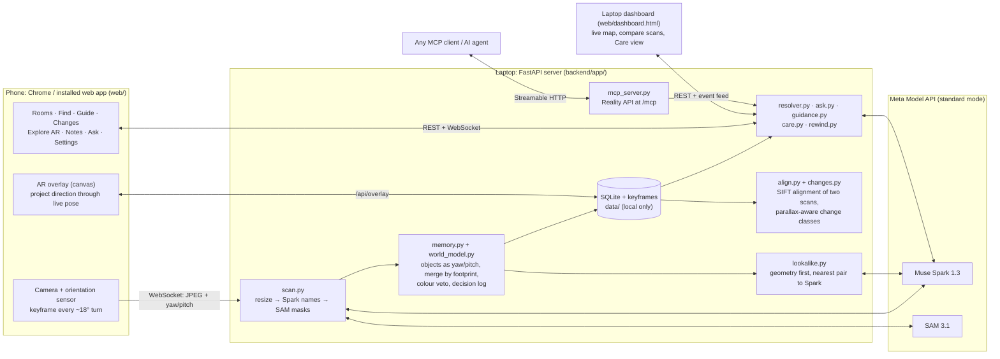

# Architecture

A phone streams keyframes with its orientation to a server on the laptop; the server asks Meta's models what is in each frame and keeps a memory of objects as directions. Everything else (Find, Guide, Changes, Notes, Ask, the caregiver view, the MCP API) reads that memory.



## Data flow

1. **Capture (phone, `web/js/camera.js`, `web/js/scan.js`).** While the user turns, a JPEG keyframe is sent over the WebSocket whenever the phone has turned about 18 degrees and is steady, with yaw, pitch and roll from the orientation sensor and the camera state (resolution, zoom). The camera only runs on a camera screen opened by a tap.
2. **Name and mask (server, `backend/app/scan.py`).** The frame is resized (960 px long side). Muse Spark lists the object types in view; SAM 3.1 runs one concept prompt per name, concurrently. A frame is stored only if every SAM call succeeded, because a stored frame means "this direction was looked at".
3. **Anchor (`backend/app/anchoring.py`).** Each detection's place in the image becomes a direction (yaw, pitch) through the phone's pose and the camera's field of view (calibrated, or 60 degrees as a placeholder).
4. **Remember (`backend/app/memory.py`, `backend/app/world_model.py`).** Sightings merge into objects by angular footprint in capture-time order; a colour histogram can veto a merge but never force one; every decision and every manual correction is logged, and corrections are replayed on every rebuild. SQLite holds rooms, scans, frames, detections, objects, notes and corrections; keyframes are JPEGs on disk. All of it stays in `data/` on the laptop.
5. **Check look-alikes (`backend/app/lookalike.py`).** After a scan: geometry first; only the nearest same-name pair goes to Spark with both crops; only a sure "same" merges.
6. **Use.** Find (`resolver.py` turns a description into a concept, the World Model answers), Guide (`guidance.py`, the direction projected through the live pose on the phone), Changes and Rewind (`align.py`, `changes.py`, `rewind.py`, below), Ask (`ask.py`, text only), Notes, the caregiver view (`care.py`, gated by the person's consent) and the Reality API (`mcp_server.py`, `reality_api.py`).

## Trust fields: what every answer says about itself

The memory is a record of what scans saw, so every answer carries how much to trust it rather than sounding certain.

| Field | Where | Meaning |
|---|---|---|
| `confidence` | each object | best SAM confidence among its sightings |
| `frames_seen` / `supporting_frames` | each object | how many keyframes saw it; one sighting is weaker evidence |
| `uncertainty_deg`, `anchor_spread_deg`, `fov_error_deg` | each object | how far its direction may be off: spread between sightings combined with field-of-view error; the guide arrow draws it as a cone |
| `last_seen`, `age_seconds` | each object | when a scan last saw it; answers say "as of the last scan", never live |
| `interpretation_confidence`, `alternates` | `where_is` | how sure Spark was that the description means this object type, and what else it could mean |
| `status`: `found` / `not_seen` / `unresolved` | `where_is` | `not_seen` comes with `coverage`: how much of the room the last scan looked at, so "not seen" is not read as "not there" |
| alignment `quality` (good / weak / failed) and its standard error | `what_changed` | how well two scans lined up; when weak or failed nothing is called moved, new or gone (except the separate `moved_low_confidence` list) |
| change class and `reason` | `what_changed` | moved, possibly moved, moved (low confidence), new, removed, or `cant_compare` with the reason (seen only once, not looked at in both scans, weak alignment) |

## Comparing two scans (Changes, Rewind, Ask's history, `what_changed`)

```text
scan A, scan B (same room, saved)
   │
   ├─ app.align.align_scans        pictures only: SIFT on every frame (features labelled with the detected object they fall on),
   │                               every frame pair for small scans (else pose prior, refine, search), rotation and essential-matrix fits,
   │                               a pair carried by one object is refitted without it, inlier-weighted median per scan
   │      ├─ offset, quality (good / weak / failed), standard error over distinct frames
   │      ├─ frame_poses        each frame of B in A's frame (removes B's sensor error and tilt bias)
   │      └─ local              per detection and frame pair: where it should appear in the other frame, from the texture around it
   │      (stored per scan pair, recomputed when ALIGN_VERSION changes)
   │
   └─ app.changes.compare_scans
          ├─ B's objects re-anchored through frame_poses; pairs of same-label objects matched by direction
          ├─ per pair: local evidence (pixels) and the viewpoint model (app.scale: size → distance → how far a viewpoint change shifts it,
          │            the viewpoint change measured from objects the local evidence shows as static, at least VIEWPOINT_ERROR_CM)
          ├─ unchanged / possibly moved / moved; when the alignment is weak: can't compare, or "moved, low confidence" (MOVED_LOW_CONFIDENCE)
          └─ unmatched objects: removed / new only if seen in two frames and the other scan looked at that spot; else can't compare + reason
```

`app.scan_quality` checks a finished scan against the same rules (frames, overlap, objects seen twice, background texture, blur) and
gives the review screen advice. `scripts/eval_alignment.py --synthetic` measures all of it on two synthetic worlds from
`tests/synthetic_world.py`: a room panorama (no depth) and a desk rendered with depth (real parallax). Decisions and thresholds:
`docs/decisions.md` (2026-10-30, 2026-10-31).
